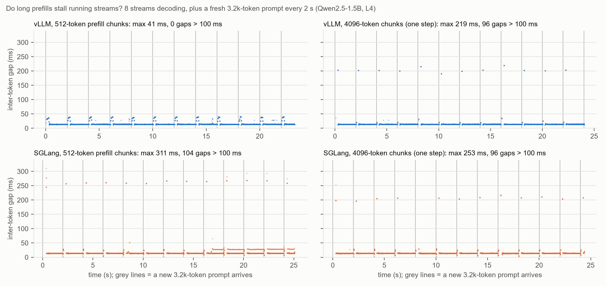
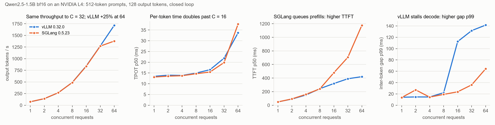

# Low-bit decode on a GPU: a Triton int4 GEMV and LLM serving benchmarks

This project asks the same question as [lowbit-decode-a53](https://github.com/FredWen-S/lowbit-decode-a53), this time on a datacenter GPU: **when do fewer bits make decode faster?**

On a Cortex-A53 phone the answer was "not below 4 bits", because unpacking int4 made decode compute-bound. A GPU has far more compute per byte of bandwidth, so the expected answer is different.

**Status (work in progress):**

1. **Triton int4 dequantize + GEMV kernel.** Batch-1 decode on an NVIDIA L4:
   - **v1** was 1.5–2.1× faster than fp16 cuBLAS on the large 7B layers, short of the predicted 2–3×. On kv_proj it was slower than fp16. The limit was memory parallelism, not unpacking ([`results/L4_v1.md`](results/L4_v1.md)).
   - **v2** adds split-K. It beats fp16 on every layer: **2.1–2.5× on the 7B layers**, and 1.2–1.5× on kv_proj ([`results/L4_v2.md`](results/L4_v2.md)).
   - **What explains it:** bytes in flight. More programs and wider tiles both raise it.
   - **Still open:** large layers stop at about 50–57% of copy bandwidth, against 3.8× ideal. Nsight Compute is next.
   - Predictions were written before each run, and the results were scored against them.
2. **vLLM 0.32 vs SGLang 0.5.23 serving benchmark.** Qwen2.5-1.5B bf16 on an L4, both engines measured by the same load generator ([`results/L4_serving.md`](results/L4_serving.md)):
   - **Batch-1 decode is at the roofline.** It runs at 13.1–13.5 ms/token in both engines, which is 99–102% of copy bandwidth for the 3.09 GB of weights.
   - **Throughput is equal up to concurrency 32.** At 64, vLLM is 25% ahead.
   - **Default schedulers make opposite trade-offs.** vLLM keeps TTFT low (p50 ≤ 421 ms) but stalls running streams (inter-token p99 113–142 ms). SGLang keeps streams smooth (24–64 ms) and makes new prompts wait (TTFT p50 up to 1.2 s).
   - **Prefix caching** cuts TTFT 5.5–6× on both.
   - **Chunked prefill protects running streams only when chunks share a step with decode.** A new 3.2k-token prompt every 2 s, with every gap recorded:
     - vLLM with 512-token chunks: max gap 41 ms.
     - 4096-token chunks: the stall is about 200 ms on both engines.
     - SGLang with 512-token chunks (`enable_mixed_chunk` is off by default): 7 back-to-back prefill batches, so the max gap is 311 ms. That is worse than not chunking.
     - p99 hid all of these stalls, because they touch under 1% of gaps.

     
   - **Predictions:** 3 of 7 held. The chunked-prefill test then took three runs: the first repeated one prompt (prefix-cache hits), and the second used p99, which cannot see rare stalls. The third run's predictions held for vLLM and failed for SGLang, for the reason above.

   
3. **BF16 vs FP8 vs AWQ vs GPTQ int4 on Qwen2.5-7B (vLLM 0.32).** Speed at concurrency 1–64, WikiText-2 perplexity and MMLU (4,681 items), all paired against BF16. AWQ also runs on vLLM's non-Marlin kernel, so the kernel's share of the speedup is visible. The harness is dry-run against a fake server. Predictions, including the bytes-per-token arithmetic, are in [`predictions_quant_2026-11-02.md`](predictions_quant_2026-11-02.md). The GPU run is pending.

## Layout

| Path | Contents |
|---|---|
| [`int4gemv/quant.py`](int4gemv/quant.py) | int4 format: group-wise asymmetric, 8 codes per int32 packed along K. Quantize / pack / unpack, plus a PyTorch reference GEMV |
| [`int4gemv/kernel.py`](int4gemv/kernel.py) | Triton kernel. The zero point is factored out of the inner sum, so dequantization costs one multiply and one subtract per row per K step |
| [`tests/`](tests/) | Correctness tests: pack round-trip, quantization error bound, and kernel vs reference over several shapes |
| [`bench/bench_gemv.py`](bench/bench_gemv.py) | Times fp16 cuBLAS, PyTorch dequantize-then-matmul, and the Triton kernel (with a config sweep) on every decode linear layer of Qwen2.5-1.5B and -7B. Reports bandwidth against the GPU's measured copy bandwidth |
| [`colab/gemv_bench.ipynb`](colab/gemv_bench.ipynb) | Runs the tests and the benchmark on a Colab GPU |
| [`bench/serve_client.py`](bench/serve_client.py) | Engine-neutral streaming load generator: closed-loop concurrency plus an optional periodic background request. Records TTFT, TPOT, inter-token gaps and server-reported token counts |
| [`bench/serve_sweep.py`](bench/serve_sweep.py) | Starts vLLM or SGLang (each from its own virtualenv) with each config, runs the experiments and stops the server. Writes one JSON per experiment point |
| [`tests/fake_engine/`](tests/fake_engine/) | A stand-in `vllm` server for dry-running the sweep without a GPU |
| [`colab/serving_bench.ipynb`](colab/serving_bench.ipynb) | Installs both engines and runs the smoke test and the full sweep on Colab. [`serving_mixed_rerun.ipynb`](colab/serving_mixed_rerun.ipynb) reruns only the chunked-prefill configs |
| [`bench/plot_serving.py`](bench/plot_serving.py) | Draws the concurrency figure from the result JSON |
| [`bench/quant_sweep.py`](bench/quant_sweep.py), [`bench/accuracy_http.py`](bench/accuracy_http.py) | Quantization comparison: one vLLM server per format, speed through the load generator, MMLU and WikiText-2 through the same server. [`colab/quant_bench.ipynb`](colab/quant_bench.ipynb) runs it |
| [`bench/plot_gaps.py`](bench/plot_gaps.py) | Draws every inter-token gap over time for the mixed workload |

## Running

Without a GPU, the kernel tests run in Triton's CPU interpreter. Triton needs Linux; on Windows use WSL.

```sh
pip install torch triton pytest
TRITON_INTERPRET=1 python -m pytest -q tests
```

On a GPU:

```sh
python -m pytest -q tests
python bench/bench_gemv.py
```

Or open the notebook in Colab with an L4 runtime.

## License

MIT
