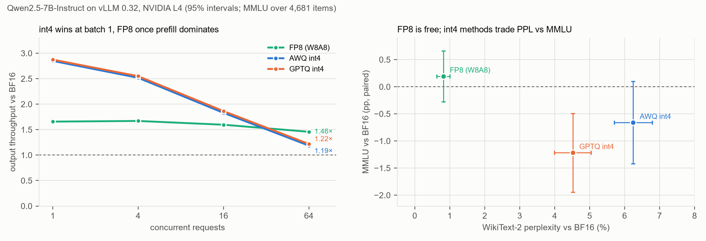

# Qwen2.5-7B on vLLM 0.32 (L4): BF16 vs FP8 vs AWQ vs GPTQ int4

**Setup:**
- Colab NVIDIA L4, vLLM 0.32.0, GPU memory utilization 0.90, 4096-token context.
- Models: Qwen's official Qwen2.5-7B-Instruct (BF16), and its `-AWQ` and `-GPTQ-Int4` releases. FP8 is vLLM's online per-tensor W8A8 quantization of the BF16 weights, using the CUTLASS FP8 kernel.
- AWQ and GPTQ both run on the Marlin kernel (`Using MarlinLinearKernel` in the logs).
- Same load generator as the serving runs: 512-token prompts, 128 output tokens, closed loop.
- Accuracy goes through the same server, and every format sees the same items:
  - MMLU: test split, every 3rd question (4,681), zero-shot letter choice;
  - WikiText-2: 100 chunks of 1,024 tokens.
- Raw data and logs: [`quant_L4/`](quant_L4/). Predictions: [`../predictions_quant_2026-11-02.md`](../predictions_quant_2026-11-02.md).

**What went wrong in the run, and what the data covers:**
- **FP8 and the first AWQ run stopped at concurrency 64.** One request's 128 tokens were all special tokens after an early EOS (`ignore_eos` keeps generating). They are stripped from streamed text, so the client saw no text and raised an error. Across the runs that finished, 0–4% of requests streamed fewer text chunks than tokens, for the same reason. The client now asks for `skip_special_tokens: false` and keeps such requests ([`../bench/serve_client.py`](../bench/serve_client.py)). TPOT is unaffected, because it uses the server's token count.
- **The `awq_nomarlin` config ran Marlin too.** vLLM 0.32 maps `--quantization awq` to `AutoAWQMarlinLinearMethod`, so the planned kernel comparison (R4) could not be made this way. It is therefore a second, complete AWQ-Marlin run. At C = 1, 4 and 16 it matches the first AWQ run within 0.5% (49 / 49, 161 / 160, 376 / 375 tok/s), a direct measure of run-to-run noise. AWQ numbers below come from this complete run.
- **FP8 was rerun alone with the fixed client** ([`../colab/quant_fp8_rerun.ipynb`](../colab/quant_fp8_rerun.ipynb), raw data in [`quant_L4_fp8/`](quant_L4_fp8/)). It completed every point, and its batch-1 TPOT matched the first run (34.1 vs 34.3 ms). FP8 numbers below come from the rerun.

## Speed

| Format | C = 1: tok/s (TPOT) | C = 4 | C = 16 | C = 64 |
|---|---|---|---|---|
| BF16 | 17 (56.5 ms) | 64 (58.3 ms) | 205 (67.4 ms) | 448 (128.0 ms) |
| FP8 | 29 (34.1 ms) | 106 (34.7 ms) | 327 (41.7 ms) | **652 (87.4 ms)** |
| AWQ int4 (Marlin) | 49 (19.0 ms) | 160 (19.5 ms) | 375 (30.8 ms) | 531 (104.6 ms) |
| GPTQ int4 (Marlin) | 50 (18.8 ms) | 162 (19.4 ms) | 382 (29.3 ms) | 546 (101.8 ms) |

**Throughput relative to BF16:**

| Format | C = 1 | C = 4 | C = 16 | C = 64 |
|---|---|---|---|---|
| FP8 | 1.64× | 1.67× | 1.59× | **1.46×** |
| AWQ | 2.85× | 2.52× | 1.83× | **1.19×** |
| GPTQ | 2.87× | 2.55× | 1.86× | **1.22×** |

### Batch 1: everything runs at the memory roofline

Bytes read per decode step, from the parameter counts in the predictions file:

| Format | Bytes per step | TPOT | Effective bandwidth | % of copy BW (231 GB/s) | % of L4 spec (300 GB/s) | Speedup vs BF16 (ideal from bytes) |
|---|---|---|---|---|---|---|
| BF16 | 14.15 GB | 56.5 ms | 250 GB/s | 108% | 83% | 1× |
| FP8 | 7.62 GB | 34.1 ms | 223 GB/s | 97% | 74% | 1.66× (1.86×) |
| AWQ (Marlin) | 4.49 GB | 19.0 ms | 237 GB/s | 103% | 79% | 2.98× (3.15×) |
| GPTQ (Marlin) | 4.49 GB | 18.8 ms | 239 GB/s | 103% | 80% | 3.01× (3.15×) |

Three things to note:
- **Copy bandwidth is a conservative line.** A copy both reads and writes. Pure weight reads reach about 250 GB/s, which is why BF16 shows 108%.
- **Marlin reads int4 weights as fast as cuBLAS reads BF16 ones,** within 5%. It delivers 95% of the ideal 3.15× and leaves no unpacking cost visible.
- **My Triton GEMV is about half as efficient.** It reached 47–57% of copy bandwidth on the same 7B layer shapes ([`L4_v2.md`](L4_v2.md)). The roughly 2× gap is a concrete target, and closing it is what Marlin's design does: weights pre-shuffled offline for wide vector loads, plus asynchronous copy pipelining.
- **FP8 is the least efficient (96%).** W8A8 also quantizes activations on every step, a small fixed cost that weight-only int4 does not pay.

### With batching the advantage disappears

At C = 16 int4 is still 1.8× faster than BF16. At C = 64 it is only 1.2× faster.

The closed loop brings 64 × ~530 prompt tokens per round, about 0.5 PFLOP of prefill on a 7B model. At an assumed ~60 TFLOPS, that is about 8.5 s per 128-step round, or about 65 ms per decode step: half of BF16's 128 ms TPOT at C = 64.

Prefill is compute-bound, and int4 does not reduce compute (Marlin dequantizes to fp16 for the matmul). So once prefill dominates, the bytes saved by int4 stop mattering. This is the GPU version of the A53 lesson: **fewer bits only help while the work is bound by reading weights.**

**FP8 overtakes int4 at C = 64** (652 tok/s against 531–546). The two formats save different things:
- **FP8 is W8A8.** Its matmuls run on the L4's FP8 tensor cores, at twice the BF16 rate, so it cuts compute as well as bytes.
- **Weight-only int4 cuts bytes only.** Marlin dequantizes to fp16 before multiplying.

So int4 wins while decode is bound by weight reads (2.9× vs 1.65× at C = 1), and FP8 wins once compute-bound prefill dominates. The crossover lies between C = 16 (int4 still ahead, 375–382 vs 327) and C = 64. **Which format is fastest depends on load**, and a benchmark at one batch size would pick the wrong one for the other regime.

## Accuracy (paired against BF16)

| Format | WikiText-2 PPL | vs BF16 | MMLU (4,681) | vs BF16 |
|---|---|---|---|---|
| BF16 | 8.087 | – | 71.14% | – |
| FP8 | 8.153 | +0.82% ± 0.10 | 71.33% | +0.19 ± 0.24 pp |
| AWQ | 8.592 | +6.25% ± 0.28 | 70.48% | −0.66 ± 0.39 pp |
| GPTQ | 8.452 | +4.52% ± 0.27 | 69.92% | **−1.22 ± 0.37 pp** |

**AWQ − GPTQ on MMLU:** +0.56 ± 0.45 pp.

**FP8 is free in accuracy.** On MMLU it is +0.19 ± 0.24 pp against BF16, inside noise, and it gives the same answer on 96.3% of the items. Its perplexity cost is +0.8%.

The two int4 methods rank in **opposite orders** on the two metrics:
- GPTQ has the lower perplexity cost (+4.5% vs +6.3%).
- AWQ has the smaller MMLU loss (−0.7 vs −1.2 pp). Only GPTQ's loss is clearly outside noise (3.3 SE).

This repeats the A53 lesson: perplexity alone does not pick the better quantization for a task.

## Scoring

| # | Prediction | Result | Verdict |
|---|---|---|---|
| R1 | BF16 TPOT at C = 1 is 60–66 ms | 56.5 ms | **Failed, faster.** The floor used copy bandwidth; weight reads reach ~250 GB/s |
| R2 | FP8 TPOT at C = 1 is 33–38 ms | 34.3 ms | **Held** |
| R3 | AWQ/GPTQ TPOT at C = 1 is 20–25 ms | 19.0 / 18.8 ms | **Failed, faster.** Marlin is at the roofline, not at 75–95% of it |
| R4 | Non-Marlin AWQ is ≥ 1.5× slower | vLLM 0.32 ran Marlin for both | **Not tested** |
| R5 | AWQ/BF16 throughput ratio at C = 64 is ≤ 1.8× | 1.19× (AWQ), 1.22× (GPTQ) | **Held** |
| R6 | MMLU: FP8 within ±0.5 pp; AWQ and GPTQ lose 0.3–2.0 pp | FP8 +0.19, AWQ −0.66, GPTQ −1.22 | **Held** |
| R7 | PPL: FP8 +0–1.5%; AWQ and GPTQ +2–8% | FP8 +0.82%, AWQ +6.25%, GPTQ +4.52% | **Held** |
| R8 | AWQ and GPTQ within 1 pp on MMLU | 0.56 ± 0.45 pp apart | **Held** |
