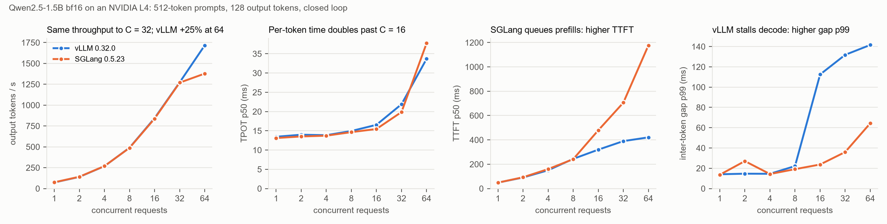

# vLLM vs SGLang on an L4: results against the predictions

**Setup:**
- Qwen2.5-1.5B-Instruct in bf16 on a Colab NVIDIA L4. Measured copy bandwidth is 231 GB/s.
- vLLM 0.32.0 and SGLang 0.5.23, each in its own virtualenv. Both get 85% of GPU memory and a 4096-token context.
- KV capacity: 561,600 tokens (vLLM) and 580,320 tokens (SGLang). That is about 15 GiB each, far more than any experiment needs.
- Both engines run their **default** scheduler settings except where a config says otherwise. SGLang's default prefill chunk is 4096 tokens; vLLM does not print its default batch-token limit.
- Every request streams with `ignore_eos`, so both engines produce exactly the requested tokens. Lengths in the tables are server-reported.
- Raw data and server logs: [`serving_L4/`](serving_L4/). Predictions: [`../predictions_serving_2026-11-01.md`](../predictions_serving_2026-11-01.md).

## Concurrency sweep

Prompts are about 532 tokens, outputs 128 tokens, closed loop. In each cell, vLLM is first and SGLang second.

| C | Output tok/s | TPOT p50 (ms) | TTFT p50 (ms) | Inter-token gap p99 (ms) |
|---|---|---|---|---|
| 1 | 73 / 75 | 13.5 / 13.1 | 49 / 49 | 14 / 14 |
| 2 | 139 / 141 | 14.0 / 13.5 | 91 / 93 | 15 / 27 |
| 4 | 268 / 269 | 13.9 / 13.7 | 150 / 160 | 15 / 14 |
| 8 | 490 / 487 | 14.9 / 14.6 | 244 / 241 | 22 / 19 |
| 16 | 844 / 838 | 16.5 / 15.5 | **319 / 479** | **113 / 24** |
| 32 | 1273 / 1270 | 21.9 / 19.9 | **390 / 706** | **132 / 36** |
| 64 | **1717 / 1378** | 33.7 / 37.7 | **421 / 1177** | **142 / 64** |

**Other workloads**, at C = 16 for the prompt-length rows and C = 8 for the prefix rows:

| Workload | Output tok/s | TTFT p50 (ms) | TPOT p50 (ms) | Inter-token gap p99 (ms) |
|---|---|---|---|---|
| 133-token prompts | 1039 / 1032 | 160 / 160 | 14.3 / 14.3 | 16 / 27 |
| 2130-token prompts | 460 / 467 | **568 / 1310** | 30.3 / 24.2 | **144 / 28** |
| 1.6k prompts sharing a 1.5k prefix, prefix cache **on** | 512 / 502 | 62 / 100 | 14.6 / 14.1 | 23 / 28 |
| Same, prefix cache **off** | 286 / 296 | 339 / 603 | 23.1 / 17.8 | 120 / 188 |

## Scoring

| # | Prediction | Result | Verdict |
|---|---|---|---|
| S1 | TPOT at C = 1 is 14–20 ms | 13.5 ms (vLLM), 13.1 ms (SGLang) | **Failed, on the fast side.** Both are *at* the weight-read floor, see below |
| S2 | TPOT(16) ≤ 1.4 × TPOT(1), and throughput(16) ≥ 10 × throughput(1) | 1.22× and 11.6× (vLLM); 1.18× and 11.2× (SGLang) | **Held** |
| S3 | At C = 64, TPOT is 1.3–2.0 × TPOT(1), and throughput is 2,000–3,500 tok/s | 2.5× and 1,717 (vLLM); 2.9× and 1,378 (SGLang) | **Failed.** The estimate left out the prefill load, see below |
| S4 | The engines' throughput is within ±15% at every point | within 3% everywhere except C = 64, where vLLM is 25% ahead | **Failed at one point** |
| S5 | Prefix caching cuts TTFT p50 ≥ 3× | 5.5× (vLLM), 6.0× (SGLang) | **Held** |
| S6 | Small prefill chunks keep decode-gap p99 ≤ 50 ms; 4096-token chunks let it reach ≥ 100 ms | rerun: 512 → 38 / 29 ms, 4096 → 22 / 26 ms | **Failed as stated.** p99 was the wrong metric for rare stalls, see below |
| S7 | At C = 16, TTFT for 2048-token prompts is ≥ 5× that for 128-token prompts | 3.5× (vLLM), 8.2× (SGLang) | **Held for SGLang, failed for vLLM** |

## What the numbers say

**1. Batch-1 decode runs at the memory roofline in both engines.**
- Each decode step reads all 1.54 B weights, which is 3.09 GB in bf16.
- At 13.5 / 13.1 ms per token that is 229 / 236 GB/s, or 99–102% of the measured copy bandwidth.
- That is the same rate the best fp16 cuBLAS GEMV reached in the kernel experiments (233 GB/s).

So there is no software overhead left to remove at C = 1. The only ways to go faster are fewer bytes (quantization) or more tokens per read (batching, speculative decoding).

**2. Batching is nearly free to C = 16, then gets expensive.**
- Up to C = 16, throughput grows 11× while TPOT rises only 18–22%.
- At C = 64, TPOT is 2.5–2.9× the batch-1 value.

My S3 estimate counted only the extra KV-cache reads (about 1.1 GB per step, +4.7 ms). It missed the prefill work that a closed loop creates: each round of 64 requests brings about 34k prompt tokens, roughly 105 TFLOP. At an assumed 50% of the L4's 121 dense TFLOPS, that is about 1.75 s per 128-step round, or about +14 ms per decode step. Then 13.5 + 4.7 + 14 ≈ 32 ms, close to the measured 33.7 ms (vLLM). The 50% is an assumption, not a measurement.

**3. With default settings the engines trade TTFT against decode smoothness in opposite directions.** This is the main difference between them, and throughput hides it.
- **vLLM** starts new prompts quickly. TTFT p50 stays at 319–421 ms from C = 16 to 64, but running streams see gaps of 113–142 ms at p99.
- **SGLang** keeps running streams smooth (gap p99 24–64 ms) and makes new prompts wait (TTFT p50 479–1,177 ms).
- **Long prompts at C = 16:** the same split shows up. vLLM has TTFT 568 ms with a 144 ms gap p99; SGLang has TTFT 1,310 ms with a 28 ms gap p99.

Which is better depends on the product. A chat UI is judged on time to first token, while a voice or streaming-TTS pipeline is judged on gaps.

*Caveat:* the closed loop starts all C requests of a round together. That is a worst case for TTFT and for prefill bursts, so the absolute TTFT numbers are pessimistic. The comparison between engines is fair, because both saw the same pattern.

**4. Prefix caching works as advertised on both.**
- TTFT p50 falls 5.5–6×.
- Throughput rises 1.7–1.8×, because the shared 1.5k-token prefill is skipped.
- Without the cache, the gap p99 jumps on both engines: 120 ms on vLLM and **188 ms on SGLang**. So SGLang's smoother decode in point 3 is not universal. When every request carries a 1.6k-token prefill at C = 8, SGLang stalls running streams as well. The mixed-workload rerun should show where its scheduler draws the line.

## The flawed experiment (S6)

The mixed workload was meant to test this: when a long prompt is prefilled while other users are decoding, do small prefill chunks keep their token gaps short?

It repeated **one** 3k-token prompt every 2 s. Prefix caching was on, so only the first arrival was really prefilled:
- The first arrival's TTFT was 276–339 ms.
- Every later arrival's was 50–75 ms. That is faster than the ~80 ms a 3.2k-token prefill needs even at the L4's peak FLOPS, so these must be cache hits.
- vLLM's log reports a prefix-cache hit rate of 66–79%.

So the 512 vs 4096 comparison (gap p99 of 16–28 ms in all four runs) says nothing about chunking.

**Fix:** a fresh random long prompt per arrival (`serve_client.periodic` now takes a list and stops when it runs out). The rerun covered only the two chunk configs, using [`../colab/serving_mixed_rerun.ipynb`](../colab/serving_mixed_rerun.ipynb). The original files are kept in `serving_L4/*/chunk*/` for the record.

### Rerun with a fresh prompt per arrival

Same engine versions (vLLM 0.32.0, SGLang 0.5.23). Raw data: [`serving_L4_mixed2/`](serving_L4_mixed2/).

The rerun is valid:
- every 3.2k-token prompt took 231–335 ms to its first token, so each one was really prefilled;
- vLLM reports a prefix-cache hit rate of 0%.

Cells give vLLM first, SGLang second.

| Prefill chunk | Short streams: TPOT p50 (ms) | Short streams: gap p99 (ms) | Long prompt: TTFT p50 (ms) |
|---|---|---|---|
| 512 tokens | 15.0 / 15.9 | 38 / 29 | 281 / 288 |
| 4096 tokens | 15.4 / 15.4 | 22 / 26 | 246 / 238 |

**What it shows:**
- Small chunks cost the long prompt 14–21% more time to first token. Its prefill is split into 7 steps, each sharing the GPU with decode.
- The decode side shows no benefit at the p99 level. The 4096-token runs even have a slightly *lower* gap p99.

**Why S6 failed: the metric, not the GPU.**
- A long prompt arrives every 2 s and stalls each of the 8 streams for one gap. That is about 100 stalled gaps out of about 12,000, under 1%.
- A p99 over all gaps cannot see an event that touches less than 1% of them.
- The concurrency sweep is different: there, every round brings 16–64 prefills, so stalls are common enough to reach p99 (113–142 ms on vLLM).

The client did not save individual gaps then, so the maximum gap cannot be recovered from these files.

**Fix for next time:** the client now keeps every gap and reports p99.9, the maximum and the count of gaps over 100 ms. A third run, about 25 minutes and under 1 compute unit, would settle whether a 4096-token chunk stalls decode for about 200 ms, as a single-step prefill should.

### Predictions for the third run, written before it (2026-11-02)

The workload is the same as the rerun: 8 short streams, plus a fresh 3.2k-token prompt every 2 s, with prefill chunks of 512 and 4096 tokens. The client now keeps every gap.

Expected stall sizes:
- **4096-token chunk:** a 3.2k-token prompt is prefilled in one step. The long prompt's TTFT was 238–246 ms, so the decode streams sharing that step should wait about 200 ms.
- **512-token chunk:** each step carries one ~512-token chunk, about 1.6 TFLOP or 25–35 ms on the L4, plus the usual ~15 ms decode work. That makes gaps of about 40–50 ms.

| # | Prediction | Would be wrong if |
|---|---|---|
| T1 | With 4096-token chunks, the maximum gap is ≥ 150 ms on both engines | < 150 ms on either |
| T2 | With 4096-token chunks there are roughly 8 gaps over 100 ms per long arrival, about 50–150 in the run | outside 50–150 on either engine |
| T3 | With 512-token chunks, the maximum gap is ≤ 70 ms and no gap exceeds 100 ms | either fails on either engine |
| T4 | p99 stays below 50 ms in all four runs, as in the rerun. The stalls exist but stay invisible to p99 | any p99 ≥ 50 ms |
